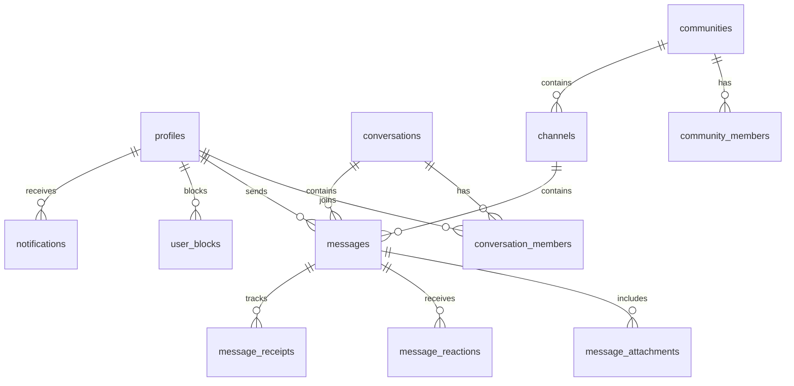

# ChatWave architecture and implementation plan

## Stack

- Next.js 15 App Router, React 19, strict TypeScript, Tailwind CSS and Lucide.
- Supabase Auth, PostgreSQL, Realtime and private Storage for production data.
- Zod for all API and form input boundaries.
- Vitest/React Testing Library and Playwright for the requested verification suite.
- Vercel for the web deployment; Supabase for managed backend services.

The repository already contains an unrelated grocery invoice app. It remains at `/`; ChatWave lives at `/chatwave` to avoid replacing it.

## Architecture

Browser components render the chat experience and call authenticated route handlers or server actions for mutations. Server code obtains the user session, validates input, checks membership and block state, and writes through a user-scoped Supabase client. Postgres RLS independently enforces the same access boundary. Realtime channels are scoped to authorized conversations and are removed on unmount. Message history uses cursor pagination ordered by `(created_at, id)`. The browser never receives the service-role key.



## Data model

- `profiles`: `id` references `auth.users`, unique normalized username, display name, bio, avatar path, presence and privacy settings.
- `conversations`: UUID, kind (`direct`/`group`), title, image path, creator, timestamps. A unique canonical key prevents duplicate direct conversations.
- `conversation_members`: conversation/user composite key, role, joined/last-read timestamps, mute/archive/pin settings.
- `messages`: UUID, conversation, sender, optional parent message, body, timestamps, edit/deletion state; indexed by `(conversation_id, created_at desc, id desc)`.
- `message_attachments`: private object path, safe display name, detected MIME type and bounded byte size.
- `message_reactions`: message/user/emoji unique key. `message_receipts`: message/user and delivered/read timestamps.
- `user_blocks`, `user_reports`, `user_settings`, `notifications`, and `push_subscriptions` hold privacy, moderation and delivery state.
- `communities`, `community_members`, `channels`, and `invitations` support scoped public/private spaces with roles and expiry/use limits.

## Security boundaries

Enable RLS on every user-data table. Profiles expose only fields intended for discovery; private settings stay owner-only. A member can select conversation messages only while a current membership row exists. Insert/update/delete policies validate both membership and `sender_id = auth.uid()`. Storage uses private buckets and path policies bound to conversation membership. Validate size and allowed file types server-side, derive MIME type from content where possible, and use short-lived signed URLs. Apply per-user message and invitation throttles, escape rendered rich content, and avoid server error details in client responses. Blocking is checked on direct-message creation and send. Report access is restricted to reporter/moderator roles.

Supabase managed email verification/reset and OAuth require project credentials and provider setup. Realtime, push notifications, audit export, backups and production monitoring need their corresponding external configuration. The current screen is a UI preview; it does not claim persistence, authentication, or realtime delivery.

## Folders

```text
src/app/chatwave/                  ChatWave routes
src/components/chatwave/           Responsive conversation UI
src/lib/supabase/                  Browser/server Supabase clients (next phase)
src/lib/chat/                      Chat queries, authorization, types
src/lib/validation/                Zod schemas
supabase/migrations/               SQL schema, indexes, RLS, storage policies
docs/chatwave-architecture.md      Decisions, setup and security notes
```

## Phases

1. Foundation: architecture, design shell, Supabase config and authentication.
2. Core messaging: conversations, durable messages, RLS, Realtime, presence, receipts.
3. Advanced messaging: attachments, replies, reactions, search, notifications, groups.
4. Communities: channels, roles, permissions, invitations and moderation.
5. Hardening: upload review, limits, pagination/performance, accessibility and responsive QA.
6. Delivery: test suite, deployment workflow, Supabase/Vercel setup, logging and backup guidance.

## Setup requirements

Create a Supabase project and configure email SMTP/templates, allowed redirect URLs, and optional Google OAuth credentials. Add only the project URL and anon/publishable key to the app environment; keep the service role key server-only. Create a private attachment bucket with a documented maximum size and MIME allowlist. Apply migrations before enabling the application. Configure Vercel environment variables and domain redirects before deployment.
